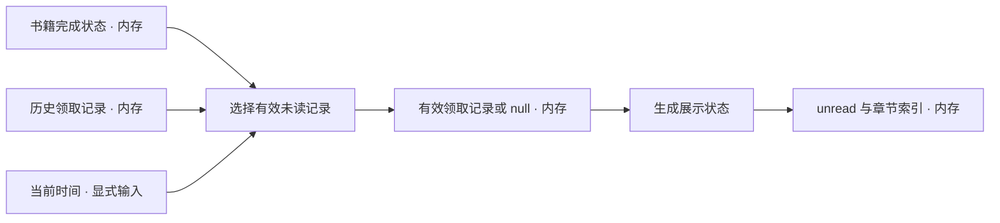

# 数据链路 Demo 库

先看数据在哪里、是什么，再看它如何被处理。每个技术点都有一份可独立运行的 demo、一篇解释原理的博客和一个可追溯的真实案例。

## 从数据链路开始

当前已有一条路线：[阅读状态：历史记录如何变成当前未读状态](maps/reader-state.md)。



处理节点绑定 [demo.mjs 中的 findUnreadGrant 与 projectUnread](demos/state/expiring-unread/demo.mjs)。这两个节点均有真实函数，其余方框表示数据。

| 阅读入口 | 内容 |
| --- | --- |
| 看数据与位置 | [数据地图](maps/reader-state.md) |
| 理解问题与取舍 | [博客：从领取记录计算未读状态](demos/state/expiring-unread/blog.md) |
| 运行和复用 | [单文件 demo 说明](demos/state/expiring-unread/README.md) |
| 核对实际来源 | [追更阅读器案例](cases/reader-unread/README.md) |
| 按技术问题查找 | [状态计算 → 带有效期记录的未读判定](demos/state/expiring-unread/README.md) |
| 供 AI 读取的关系索引 | [catalog.json](catalog.json) |

## 直接运行

Node.js 22 或更高版本，无需安装依赖。

```sh
npm run demo
npm run check
```

也可以只复制 [demo.mjs](demos/state/expiring-unread/demo.mjs) 到任意目录，执行 `node demo.mjs`。文件包含处理函数、合成样例和运行入口。

## 博客、Demo、真实案例

博客解释数据链路、处理方法和适用边界；demo 给出可执行实现；案例记录实际触发条件、来源源码及与 demo 的差异。文章当前为**待作者审查**的仓库内博客，外部平台尚未发布。

扩充时先确定一条真实的数据路线，再提炼其中值得复用的处理问题。一个 demo 可以出现在多条地图中，代码保留一份。数据类型、位置、问题、实现语言分别写入索引，避免把 JSON 格式、跨进程边界和状态计算混在同一分类层。

## 文书直接读取 GitHub

正式资料入口为本仓库的 [catalog.json](catalog.json)，读取约定见 [GitHub 资料源](docs/github-source.md)。先将 `main` 解析为一个提交 SHA，再按同一 SHA 读取博客、代码和案例。文章仍为待审草稿，公开可读不等于作者已审定。

文书的 GitHub 读取接入由文书侧实现；本仓库提供资料和稳定的相对路径。审查时记录提交号，后续推送不会悄悄替换已经使用的代码版本。

## 首次本地文书审查包

```sh
npm run review -- /path/to/md-review
```

该命令使用本机文书源码的项目 API，在 `artifacts/review/` 新建审查快照，保留博客主稿、原始代码附件、可读取的代码资料和源码哈希。每次生成新目录，已有审查记录不覆盖。命令不会调用模型。

在文书选择“文件 → 打开文章项目”，打开输出文件夹。审查后的主稿由作者核对后同步回博客源文件；审查不会直接改动 demo。接入 GitHub 后，后续文章可直接以提交版本作为参考资料来源。

## 继续添加

按 [CONTRIBUTING.md](CONTRIBUTING.md) 添加，使用 [demo 说明模板](templates/demo.md)、[博客模板](templates/blog.md) 和 [案例模板](templates/case.md)。自动检查会拒绝缺少博客、案例、数据地图或源码绑定的条目。

当前只建立用得到的目录。测试、权限、日志、发布等跨越多条数据链路的内容，在有实际 demo 时再添加相应入口。

首个 demo 基于阅读器 AGPL 源码提炼，本仓库使用 [AGPL-3.0](LICENSE)，来源与改写范围见 [NOTICE.md](NOTICE.md)。

初版验证与尚未覆盖的范围见 [交付验证](docs/verification.md)。
