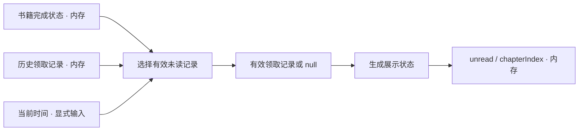

# 从领取记录计算未读状态：有效期与重复领取的处理

状态：待作者文书审查；外部博客尚未发布。

[运行 Demo](README.md) · [完整单文件代码](demo.mjs) · [实际使用位置](README.md#实际使用) · [数据地图](../../../maps/reader-state.md)

追更阅读器里，同一章临时领取后没读完，过期了。重新领取，再读完，未读红点却还亮着。账本里已经有这章的完成记录，界面也能显示完成进度。

问题出在计算未读时，把两种不同层次的状态拼在了一起。要看清它，先把数据摆出来。

## 数据先经过哪里

本例需要三份输入：当前书籍状态、领取记录列表，以及当前时间。它们都在同一个进程的内存中。书籍状态保存已经完成的章节；领取列表保留每次领取是否完成、什么时候有效。



读取文件、传消息、绘制红点都在这段处理之外。先单独确认：给定这三份输入，应该得到什么未读状态？

## 一章可以有多条领取记录

为了能反复运行，demo 用一条合成时间轴，数值单位都是毫秒。章节索引从 0 开始。

| 时刻 | 领取记录 | 书籍已完成章节 | 预期未读 |
| --- | --- | --- | --- |
| 1500 | 第一次领取，区间 `[1000, 2000)`，未完成 | `[]` | true |
| 2000 | 第一次领取已过期，记录仍保留 | `[]` | false |
| 2500 | 第二次领取，区间 `[2000, 3000)`，未完成 | `[]` | true |
| 2600 | 第二条记录完成，第一条仍是未完成 | `[0]` | false |

最后一行最容易漏掉。完成第二次领取，并不意味着要把第一次领取的历史记录也改成完成。历史列表可以保留原状，查询函数需要理解它。

最后一个时刻的完整最小输入如下，对应 demo 中的“重领后完成”。时间和书籍标识都是合成数据。

```json
{
  "book": { "key": "sample-book", "startIndex": 0, "completed": [0] },
  "grants": [
    { "key": "sample-book", "index": 0, "temporary": true, "at": 1000, "until": 2000, "completed": false },
    { "key": "sample-book", "index": 0, "temporary": true, "at": 2000, "until": 3000, "completed": true }
  ],
  "now": 2600
}
```

原来的故障逻辑近似于：找到一条没有完成的领取记录，再检查对应章节现在能不能访问。下面是测试里重建的最小判定，`isAllowed` 是真实阅读器中的章节访问检查。

```js
const legacyUnread = account.grants.some(grant =>
  grant.key === key && !grant.completed &&
  isAllowed(account, key, grant.index, now)
);
```

第一条记录符合“没有完成”；章节又因为已经读完而获得永久访问权限，两项检查都通过了。于是，一条过期记录重新变成了未读依据。

这里，“章节能访问”回答的是权限问题；“这次领取仍有效且尚未读完”回答的是当前未读问题。两个问题需要各自的判定条件。

## 先选记录，再生成展示数据

选择一条有效未读记录，需要同时满足：属于当前书籍、位于追更起点之后、这条记录未完成、对应章节尚未完成，而且记录仍然有效。

```js
export function findUnreadGrant(book, grants, now) {
  return grants.find(grant =>
    grant.key === book.key && grant.index >= book.startIndex &&
    !grant.completed && !book.completed.includes(grant.index) &&
    (!grant.temporary || now >= grant.at && now < grant.until)
  ) ?? null;
}
```

`book.completed` 排除已经在其他领取记录下完成的章节。时间区间采用左闭右开，恰好到 `until` 时，临时记录就失效。正式记录永久有效，是阅读器当前的业务规则。

函数按领取列表顺序返回第一条符合条件的记录。结果保留记录本身，调用方既能生成未读标记，也能取得应该打开的章节。

```js
export function projectUnread(book, grants, now) {
  const grant = findUnreadGrant(book, grants, now);
  return { unread: grant !== null, chapterIndex: grant?.index ?? null };
}
```

这里还有一个很小的坑：第 0 章是有效章节，不能用 `Boolean(chapterIndex)` 判断有没有未读。空结果明确使用 `null`，索引 0 就不会被误当作没有结果。

代码只查询输入，不修改领取记录，也不在函数内部读取系统时钟。传入相同的状态和时间，就能重现同一个结果。

## 运行这个 Demo

安装 Node.js 22 或更高版本，把 [demo.mjs](demo.mjs) 单独下载到任意目录，运行：

```sh
node demo.mjs
```

文件内包含处理函数、四个阶段的合成数据和命令入口。控制台会显示四行，`unread` 依次为 `true、false、true、false`。

如果克隆了整个仓库，还可以运行：

```sh
node --test demos/state/expiring-unread/demo.test.mjs
```

测试既覆盖有效期边界、跨书隔离、完成状态、追更起点和第 0 章，也重建了那条错误判断：旧逻辑在“重领后完成”时返回未读，修正后的计算返回已读。另有用例将提炼后的函数与[真实源码选段](reader-source.cjs)对照。

对于上面的最终输入，`projectUnread(input.book, input.grants, input.now)` 的预期输出为：

```json
{ "unread": false, "chapterIndex": null }
```

它同时满足两个可核对的事实：第一次领取记录仍然保持未完成，章节当前已经完成。计算结果不要求清理或改写那条旧记录。

## 放回真实项目时要核对什么

追更阅读器的实际修复让展示快照和阅读入口共用 `unreadGrant`。两处都从相同规则选择未读记录，避免红点与打开的章节各算一套。

完整任务栏还会把“现在可以领取”叠加到红点上。因此，本文的函数只负责已有领取记录的未读状态。读完当前章之后，如果下一章已经可以领取，真实应用仍然可能显示提示。

这种处理可以用于带有效期的任务或通知，但迁移前需要确认三个条件：完成状态是否可信、时间是否来自同一时间轴、列表顺序是否符合所需的优先级。多设备离线写入时，还要先解决完成状态的合并问题。

这个 demo 留下的是一段清楚的计算边界：输入历史记录和当前完成事实，输出此刻仍需关注的记录。下次界面状态与历史账本看起来矛盾时，可以先把这几份数据单独拿出来运行，再追查外围的读取、同步或绘制。
