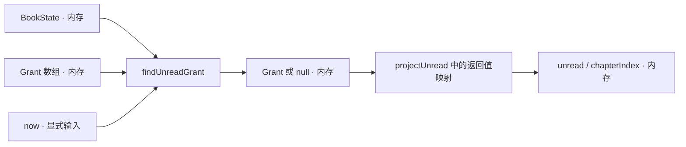

# 阅读状态：历史记录如何变成当前未读状态

[返回技术地图](../README.md) · [博客](../demos/state/expiring-unread/blog.md) · [独立 Demo](../demos/state/expiring-unread/README.md) · [真实案例](../cases/reader-unread/README.md)

## 先看数据

| 数据 | 位置 | 关键字段 | 含义 |
| --- | --- | --- | --- |
| 书籍状态 `BookState` | 同一进程内存 | `key, startIndex, completed` | 当前书籍、追更起点、已经完成的章节 |
| 领取记录 `Grant[]` | 同一进程内存 | `key, index, temporary, at, until, completed` | 每次领取的章节、有效期和当次完成标记 |
| 当前时间 `now` | 调用方显式传入 | 数值 | 与记录使用相同时间单位 |
| 有效未读记录 | 函数返回值，内存 | `Grant` 或 `null` | 本次真正需要关注的记录 |
| 展示状态 | 函数返回值，内存 | `unread, chapterIndex` | 未读标记及目标章节索引 |

## 再看处理

两个处理节点对应 [demo.mjs](../demos/state/expiring-unread/demo.mjs) 中的真实导出函数。`projectUnread` 内部调用 `findUnreadGrant`，图中展开的是这条调用的数据流。

`findUnreadGrant` 检查书籍、追更起点、领取记录的完成状态、章节最终完成状态，以及临时记录的有效区间。`projectUnread` 将结果映射为展示数据；找到第 0 章时仍应输出 `unread: true`。

真实应用还包含磁盘读取、领取调度、IPC 和界面绘制。这里仅提取已经落地的内存状态计算，不把这些外围环节标为已有 demo。特别是原任务栏的红点还可能表示“现在可以领取”，与本例的未读标记是两个输入条件。

## 复用入口

- 数据类似：限时通知、领取任务、临时访问记录。
- 问题类似：旧记录保留着未完成标记，但资源已在另一条记录下完成。
- 使用前核对：最终完成状态是否可信、时间由谁提供、列表顺序是否就是所需优先级。
- 有多设备并发或离线合并时，需要先解决完成状态和时间的一致性，再使用此计算。
